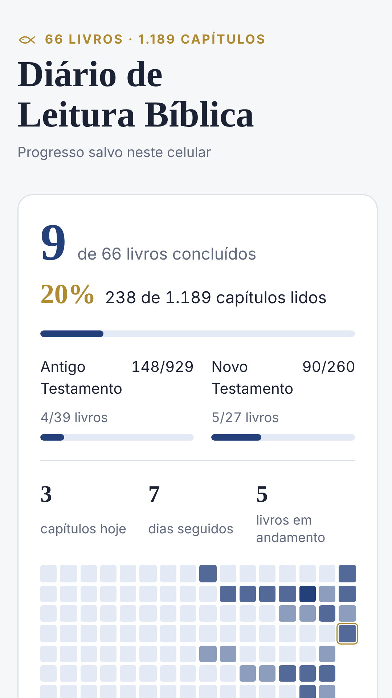
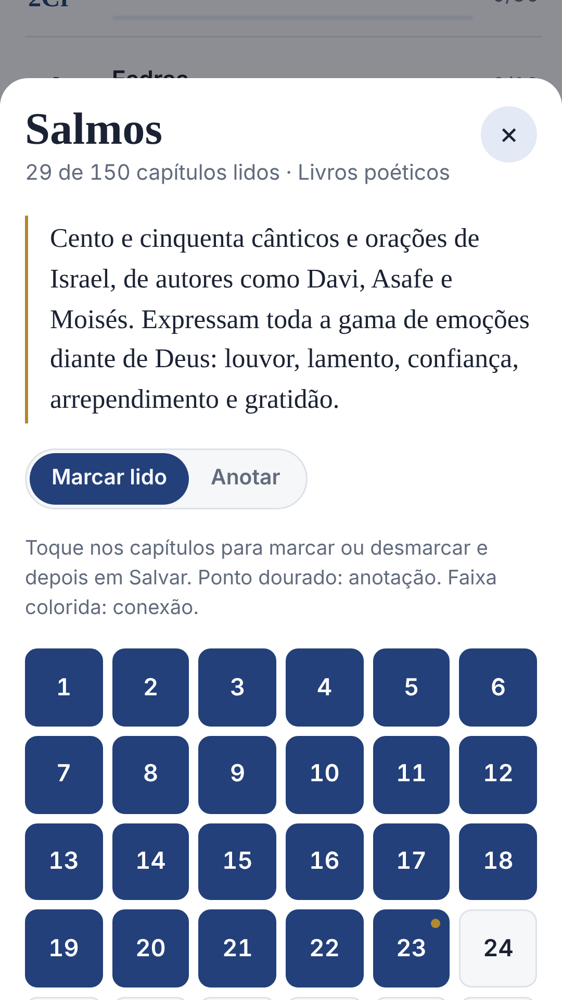
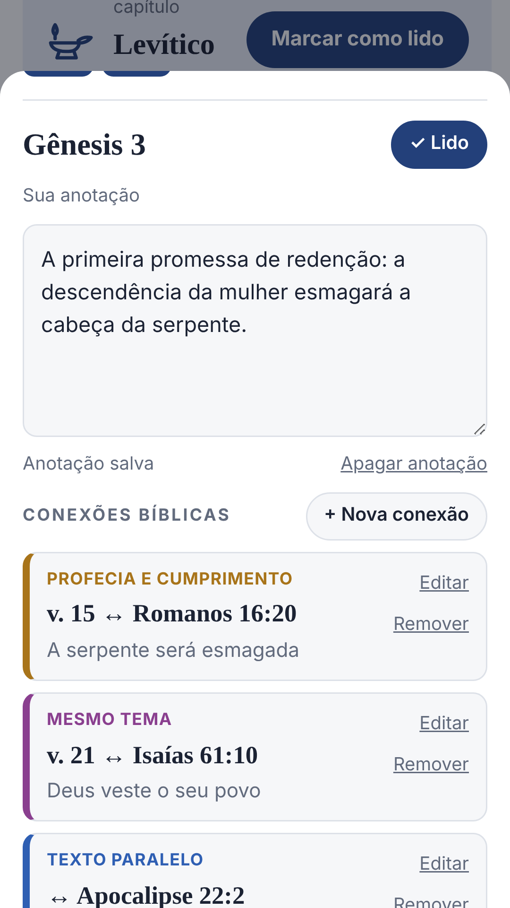

<p align="center">
  
</p>

<h1 align="center">Leitura Bíblica</h1>

<p align="center">
  Diário de leitura bíblica para marcar os capítulos lidos, anotar e ligar passagens.<br>
  Funciona offline, sem cadastro e sem anúncios.
</p>

<p align="center">
  <a href="https://guilhermeldps-debug.github.io/Leitura-biblica/"><strong>Abrir o app</strong></a>
  ·
  <a href="https://guilhermeldps-debug.github.io/Leitura-biblica/privacidade.html">Política de privacidade</a>
</p>

<p align="center">
  
  
  
</p>

---

## Funcionalidades

**Leitura**
- Os 66 livros e 1.189 capítulos, agrupados por seção (Pentateuco, Históricos, Poéticos, Profetas, Evangelhos, Cartas, Apocalipse).
- Ordem **bíblica** ou **cronológica** aproximada, agrupada por época.
- Marcação de capítulos com **confirmação em "Salvar"**: nada muda sem você confirmar, e o app avisa se você tentar sair com alterações pendentes.
- Botão **Próximo capítulo**, que segue a ordem escolhida.
- Um resumo curto do assunto de cada livro.

**Progresso**
- Livros concluídos em destaque, capítulos lidos e percentual, no total e por Testamento.
- Capítulos lidos hoje, dias seguidos e livros em andamento.
- Mapa das últimas 16 semanas de leitura.

**Estudo**
- Anotações em cada capítulo, salvas automaticamente.
- **Conexões bíblicas** entre passagens, em quatro tipos com cores próprias: profecia e cumprimento, texto paralelo, citação e mesmo tema. A conexão aparece nos dois capítulos e pode ser editada ou removida.
- Aba **Anotações** com busca em todas as anotações e conexões.

**Do seu jeito**
- Tema automático, claro ou escuro.
- Instalável no celular (PWA) e funciona sem internet.

**Backup**
- **Google Drive** (opcional): salva sempre no mesmo arquivo, `backup-leitura-biblica.json`, na pasta "Leitura Bíblica" do seu Drive. Cada backup substitui o anterior, e a restauração mostra um resumo antes de substituir o progresso.
- **Arquivo no celular:** exporta e importa um `.json`.

> O app não traz o texto bíblico. Use-o junto com a sua Bíblia preferida, impressa ou digital.

## Como instalar

| Onde | Como |
|---|---|
| **Android** | Abra o [app](https://guilhermeldps-debug.github.io/Leitura-biblica/) no Chrome → menu ⋮ → **Instalar app**. |
| **iPhone** | Abra no Safari → Compartilhar → **Adicionar à Tela de Início**. |
| **Computador** | Abra no Chrome ou no Edge e clique no ícone de instalar na barra de endereço. |

A versão para a Google Play Store está em preparação. Veja [`PLAYSTORE.md`](PLAYSTORE.md).

## Privacidade

- Progresso, anotações e conexões ficam **só no aparelho** (armazenamento local do navegador). O app não tem servidor próprio.
- Sem cadastro, anúncios, ferramentas de análise ou rastreamento.
- O backup no Google Drive é opcional e vai **direto do aparelho para a conta do próprio usuário**, com a permissão `drive.file`: o app só enxerga os arquivos que ele mesmo criou.

Detalhes na [política de privacidade](https://guilhermeldps-debug.github.io/Leitura-biblica/privacidade.html).

## Estrutura do projeto

É um site estático, sem etapa de build e sem dependências: HTML, CSS e JavaScript puros, publicado pelo GitHub Pages a partir da branch `main`.

```
├── index.html              App completo (interface, estilos e lógica)
├── sw.js                   Service worker: cache offline do app e das fontes
├── manifest.json           Manifesto do PWA (nome, cores, ícones, capturas)
├── privacidade.html        Política de privacidade
├── icons/                  Ícones do app (normal e maskable)
├── screenshots/            Capturas usadas no manifesto e na loja
├── loja/                   Imagens da ficha da Play Store
├── .well-known/            Modelo do assetlinks.json (TWA)
├── .nojekyll               Faz o GitHub Pages servir a pasta .well-known
├── PLAYSTORE.md            Textos da ficha e passo a passo da Play Store
└── GOOGLE-DRIVE.md         Configuração do backup no Google Drive
```

### Onde ficam os dados

| Chave no `localStorage` | Conteúdo |
|---|---|
| `leitura-biblica-v1` | Capítulos lidos, dias de leitura, anotações e conexões |
| `leitura-biblica-tema` | Tema escolhido |
| `leitura-biblica-ordem` | Ordem dos livros (bíblica ou cronológica) |
| `leitura-biblica-drive` | Conta do Drive exibida e data do último backup |

O formato do backup (`.json` em arquivo ou no Drive) é o mesmo: `{ app, v, savedAt, read, days, notes, links }`.

## Desenvolvimento

1. Clone o repositório e sirva a pasta com qualquer servidor estático. O service worker não funciona abrindo o arquivo direto (`file://`):
   ```bash
   python3 -m http.server 8000
   ```
   e abra `http://localhost:8000/`.
2. Ao publicar uma mudança, **aumente a versão em `sw.js`** (`const VERSION = "vNN"`), para que os celulares troquem o cache antigo pelo novo.
3. O backup no Drive usa o ID do cliente OAuth definido em `DRIVE_CLIENT_ID`, no `index.html`. O login só funciona nos endereços cadastrados no Google Cloud. Para testar localmente, cadastre também `http://localhost:8000` (origem) e `http://localhost:8000/` (redirecionamento). Veja [`GOOGLE-DRIVE.md`](GOOGLE-DRIVE.md).

## Documentação

- [`PLAYSTORE.md`](PLAYSTORE.md): textos da ficha, imagens, Segurança dos dados, geração do AAB no PWABuilder e teste fechado.
- [`GOOGLE-DRIVE.md`](GOOGLE-DRIVE.md): como criar o ID do cliente OAuth e o que fazer em caso de erro.

## Contato

Sugestões e problemas: abra uma [issue](https://github.com/guilhermeldps-debug/Leitura-biblica/issues).
